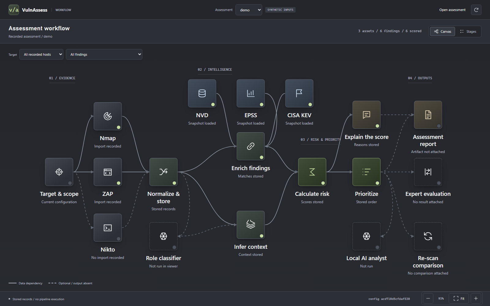
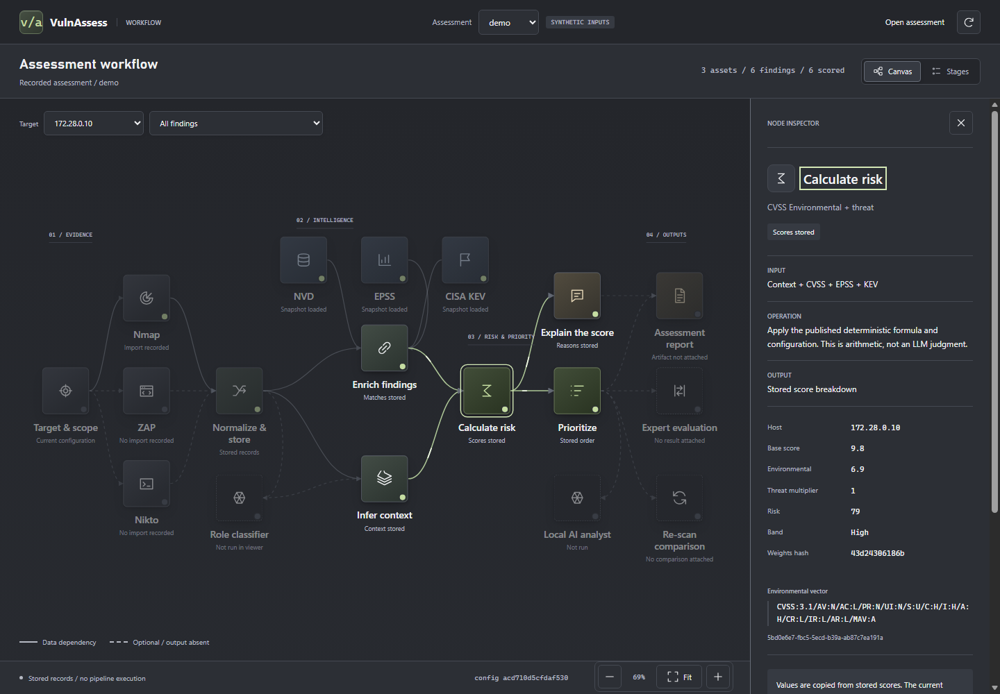
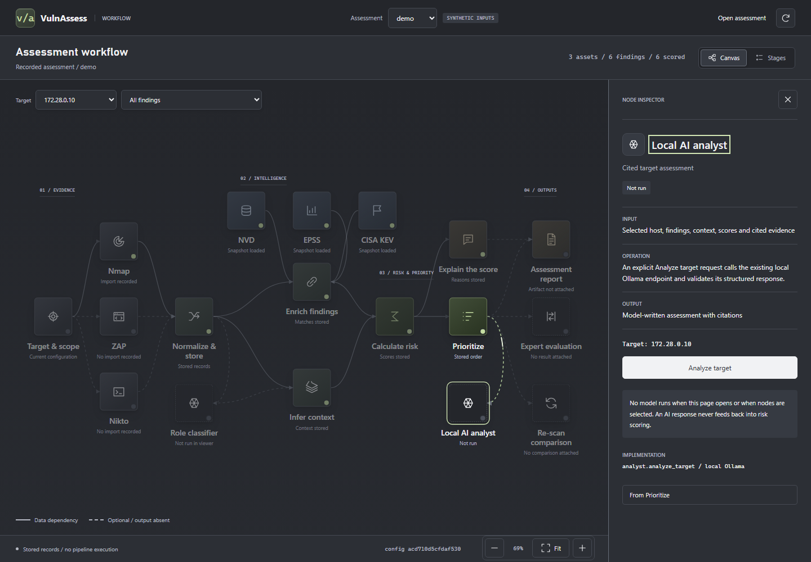
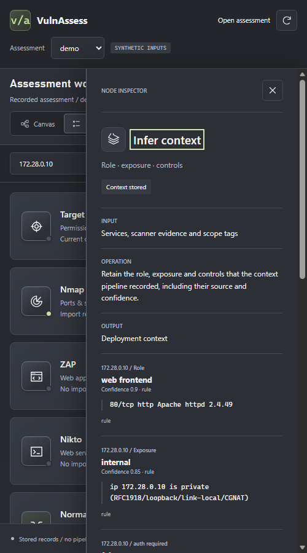

# vulnassess — rank vulnerabilities by risk *to this network*, not by CVSS alone

VulnAssess collects or imports authorised scanner evidence, combines available
vulnerability intelligence with deployment context, calculates transparent priorities,
and uses validated AI output to explain findings and propose verification steps.
CVSS supports Environmental metrics; this project's method attempts to infer some of
their inputs from evidence rather than assuming a base score describes the deployment.

The implementation is **local-first, not unconditionally offline**. Recorded processing
can use supplied NVD/EPSS/KEV snapshots. The live path can query publishers, and explicitly
selected cloud models receive bounded evidence after consent. Ollama is the local option.
Canonical scores and scope decisions remain deterministic, outside model control.

**Public Website Check:** open `/website-check` in the local UI (also linked from
the workflow). This separate, human-confirmed mode checks one public HTTP/HTTPS
root response, TLS trust/expiry and minimised security metadata. It does not run
the deep scanners, follow redirects, retain page bodies or change canonical scores.
Private/internal destinations and canaries are blocked. See WEB-02 in
[decisions](docs/decisions.md) for the approved exception and verification scope.

Release verification, 20 October 2026: the clean team checkout passed Ruff lint,
Ruff formatting (295 files), offline Pyright (zero errors) and the full offline
suite: **4,270 tests plus 530 subtests passed, 99.34% Python statement coverage**.
The included synthetic demo also generated its database and report successfully.
These checks do not establish live-scanner readiness or real-model accuracy;
local Nmap still requires the complete installation described below.

Current project references, updated 20 October 2026:

- [Plain-language guide](docs/PROJECT_GUIDE_FOR_EVERYONE.md): what the tool does and how to read a result.
- [Technical reference](docs/TECHNICAL_PROJECT_REFERENCE.md): 42 numbered sections covering architecture, source paths, formulas, AI boundaries, capabilities, limits, and developer handoff.
- [Working-tree audit status](docs/TECHNICAL_PROJECT_REFERENCE.md#40-17-october-working-tree-status-and-unresolved-cracks): reproduced defects, repairs, and verification scope. A feature listing is not a declaration of completion.
- Latest completed development-tree check ([WEB-02 decision and evidence](docs/decisions.md)): 4,260 tests plus 530 subtests passed at 99.34% Python statement coverage. The new Public Website Check is separate from authorised deep scanning and retains minimal HTTP/TLS metadata. Canonical scope and scores stay unchanged. Public transport tests use fakes; no real website or AI call was made by the agent. This is not full-site crawling, detection accuracy or real-model acceptance. The earlier [4,194-test checkpoint](docs/TECHNICAL_PROJECT_REFERENCE.md#4024-minimal-website-metadata-and-whole-tree-verification) remains historical; a unified live/database/report lifecycle is still unfinished.

```text
Same CVE, same CVSS base - different risk:  CVE-1999-9001

                                 172.28.0.12       172.28.0.10
CVSS base                                9.8               9.8
Role                                database      web_frontend
Exposure                     internet_facing          internal
WAF                                       no                no
EPSS percentile                          100               100
KEV                                      yes               yes
CVSS environmental                       9.8               6.9
RISK                                   100.0              79.0
BAND                                Critical              High
```

(A synthetic acceptance case: it demonstrates the mechanism, and is labelled as such
everywhere it appears.)

## Quickstart

### Team checkout: start here

This repository contains the project source, tests, curated fixtures, configuration,
bundled UI assets and labelled synthetic role-model artifact. It deliberately does
not contain API keys, local databases, complete intelligence feeds, raw live scans,
installed scanner binaries or local recovery history. Each teammate supplies their
own approved dependencies and optional tools; do not share `.env` files.

After preparing the dependencies listed below, the offline synthetic demo creates
the local database needed by the UI. These are commands for the teammate to run:

```bash
python run_demo.py
python -m vulnassess --db data/vulnassess.db --config config ui --run demo --port 8765
```

Open `http://127.0.0.1:8765/`. The demo is synthetic, not a completed live scan.
Use `/website-check` for the separate, explicitly confirmed public metadata mode.
AI is optional and requires the appropriate local model or individually configured
provider credentials and consent. The existing database and `scanme-2026-09-24`
assessment on the maintainer's computer are not copied into a fresh checkout.

For live assessment, Nmap needs its complete installation, including
`nmap-protocols`, `nmap-services` and `nmap-service-probes`, not just `nmap.exe`.
The preflight identifies missing data before a scan starts. Nikto requires its
own Perl dependencies; Nessus remains an imported-report path. Use authorised
targets only. Training and research tooling is present, but independent real-host
labels, expert evaluation and completed LLM fine-tuning are not supplied results.

Python 3.11+; declared runtime dependencies are `pyyaml`, `packaging`, and
`psycopg[binary]>=3.2,<4`. External scanners, Perl modules, and models are separate
prerequisites. Follow [the operating instructions](.github/copilot-instructions.md)
and [security guide](docs/security.md); the agent does not install or download them.

The following examples are **NOT RUN** by this documentation update. They require
existing authorised captures and approved feed files.

```bash
# 1. Inspect the local command surface:
python -m vulnassess --help

# 2. Optional labelled synthetic demonstration, not real scanner evidence:
python run_demo.py                        # writes reports/demo.html

# 3. Process supplied authorised scan output and supplied feed snapshots:
vulnassess intel load --from-dir data/feeds
vulnassess import --run-id lab1 --target-ip 172.28.0.10 --nmap out.xml
vulnassess enrich  --run-id lab1
vulnassess context --run-id lab1
vulnassess rank    --run-id lab1
vulnassess report  --run-id lab1 --out reports/lab1.html
```

Historical feed provenance is recorded in [FEED_PROVENANCE.md](docs/FEED_PROVENANCE.md).
It does not prove that a current cache is present or fresh. Download-capable helpers
are **not run by the agent**; on-demand publisher calls are a separate,
explicitly network-backed runtime path.

## What it does with your scan

1. **Match** each finding to a CVE — the ID the scanner named explicitly, or CPE
   version-range matching against NVD's configuration data, with a recorded
   accept/reject trace for every decision.
2. **Enrich** from the offline snapshots: CVSS v3.1/v4.0 vectors, EPSS score and
   percentile, KEV presence, patch references, description.
3. **Infer context from the scan itself**: host role, internet-facing vs internal,
   WAF observed, authentication observed — each inference carries a confidence, a
   source, and the verbatim scan quote that triggered it (or `none observed`).
4. **Map eligible context to CVSS v3.1 Environmental metrics:** configured mappings
   can adjust `MAV`, `MAC`, `MPR`, and C/I/A requirements. Finding-specific checks
   withhold unrelated or insufficiently supported control effects. These mappings
   are research hypotheses, not proof that an observed control mitigates a flaw.
5. **Score**: `risk = environmental × 10 × threat`, `threat = 0.5 + 0.5 × EPSS
   percentile`. A missing EPSS row is **unscored, not defaulted**. A KEV listing
   forces `threat` to 1.0 and adds 10 — but the Critical floor of 90 applies **only
   when the host is internet-facing**. An internal host can still reach Critical
   through its computed priority. The formula lives in `config/weights.yaml` and its
   hash is printed in every report footer.

## Where the LLM fits (and where it cannot go)

`vulnassess explain` may hand a finding to local Ollama to reword its one-line rationale.
The live workbench also has an explicit **Analyze target** action. It sends the selected
host's stored services, findings, context, CVSS, EPSS, KEV and deterministic scores to a
selected model, then validates the structured response and rejects unknown finding or
evidence citations. The analyst can correlate evidence and suggest a remediation order;
it cannot overwrite canonical scores, context or records. No analysis runs while loading
the page. Model availability and output validation have outcomes independent of
successful evidence collection; rejected prose is withheld.

## What is real, and what is not

- **Code verification:** exact command, date, test counts, and coverage belong in the
  [latest completed development-tree check](docs/TECHNICAL_PROJECT_REFERENCE.md#4013-h1-provenance-and-context-artifact-consistency-follow-up),
  not an undated count. Mocks establish tested paths, not current integration availability.
- **Curated captures/feed records:** consult each fixture's provenance. Scanner-named
  CVEs are associations, not independently confirmed exploitation. Historical snapshots
  do not certify today's cache.
- **Real Nikto fixture:** MISSING independently captured JSON with completed provenance
  under `tests/fixtures/nikto/`; its supplied EXAMPLE file is synthetic.
- **Model execution:** past individual runs do not prove current serving availability.
  A deterministic explanation is available without model generation.
- **Demo inputs:** synthetic and labelled; never evidence about real systems.
- **Learned role model:** shadow/candidate only; not a canonical scoring input.
- **Research claims RQ1–RQ4:** not established by passing tests. Independent real truth,
  frozen cohorts, and expert rankings are required.

Engineering verification reports distinguish `VERIFIED`, `TESTED WITH MOCKS`,
`NOT RUN`, and `MISSING`. Model claims use their separate observed/inferred/hypothesis/
unknown labels. Anything under `tests/synthetic/` is not evidence about real systems.

## Safety model

`scan` **plans by default** — it prints the Nmap-first command, prefixed
`not run by the agent`, and executes nothing. Only a human passing `--execute` runs
scanners, and only against hosts inside `config/scope.yaml`; the fence is checked
before scanner execution, and the configured canary must remain outside scope.
Nikto is planned only after supported HTTP(S) evidence; ZAP is an import reader,
not a current executable-tool option. This is a defensive assessment tool with fixed,
bounded probes, not a general exploitation or automatic-remediation engine.

## Commands

```text
vulnassess scan      --run-id R --target-ip IP [--tool nmap|nikto] [--execute]
vulnassess import    --run-id R --target-ip IP [--nmap out.xml] [--nikto out.json] [--nessus report.nessus]
vulnassess intel     load --from-dir data/feeds | status
vulnassess enrich    --run-id R          # match CVEs against the offline snapshots
vulnassess context   --run-id R          # infer role/exposure/controls with quotes
vulnassess rank      --run-id R [--top N]
vulnassess explain   --run-id R [--model NAME] [--ollama-host URL] [--no-model]
vulnassess report    --run-id R --out reports/R.html
vulnassess eval      --run-id R --truth truth.yaml | --live
vulnassess diff      --before R1 --after R2
vulnassess demo      --target IP:nmap.xml[:zap.json] --feeds DIR --out PATH
```

Model, research, snapshot, unify, rescan and visualize subcommands: see
`vulnassess --help` and `docs/`. Every command takes `--json`. Exit codes: `2` config,
`3` scope, `4` scanner file, `5` missing feed snapshot, `6` model unavailable.

## Interactive views

The four-stage workbench presents the stored assessment. A separate Make-style
workflow canvas shows the project's data dependencies and inspects the same records:

```text
vulnassess ui --run R --port 8765                 # loopback workbench; explicit Nessus import
vulnassess ui --run R --model llama3.2:3b         # enable explicit local target analysis
vulnassess ui --run R --export reports/R-ui.html  # one offline HTML file
python run_visual_simulation.py                    # same UI, synthetic demo data
```

`vulnassess visualize` remains a compatibility alias for the same offline workbench
export. It no longer renders the historical eight-stage replay. `vulnassess report`
is the printable assessment artifact, not a competing application. Live and exported
views share the same renderer, controls, evidence inspector and Risk analytics.

Open `/workflow?run=R` on the local viewer for the workflow canvas. It is a live-only
view, separate from the workbench and its single-file export. Press **Run**, enter
an authorised IP or hostname, and choose **Run live target**. This checks scope,
pins a single resolved address, scans the top 100 TCP ports with light Nmap service
detection, normalizes the observed services and findings in memory, looks up
scanner-named CVE IDs on demand from NVD, FIRST EPSS and CISA KEV when findings
exist, and stores publisher data in a separate `data/intel-cache.db` cache. It infers
context, and calculates deterministic scores only when vulnerability findings exist.
The selected analyst receives those bounded inputs. Evidence summaries remain useful
when AI is unavailable or needs review; rejected AI output is withheld. Requested
scanner failures retain a partial scan outcome instead of being labelled complete.
Raw files, case manifests and review checkpoints are retained locally, but live results
are not automatically written into a recorded SQL assessment or printable report.
Without findings, feed
enrichment and scoring are marked not applicable rather than completed. The
on-demand cache is not a full NVD mirror; the Run panel shows which publisher
records are present and their dates. Test fixtures in the recorded assessment
are never treated as operational intelligence. A cloud database is not queried
for feed snapshots by this live path. The server
checks that Nmap starts before each live run. It uses `VULNASSESS_NMAP_BIN` when
set, otherwise the server's PATH, then the Windows Nmap install registry. The
target check and `/api/scanner-status` report the discovered path or exact preflight
failure. A completed scan is held in server memory for 10 minutes so a failed model request can be retried without running Nmap again. Another live scan of the same target is blocked during that period; restarting the server clears the in-memory evidence.
Use **Preview example** and **Preview flow** to watch five labelled simulations:
light Nmap with no findings, a full web path, skipped Nikto when HTTP is absent,
model unavailability, and a target outside scope. The full web path illustrates
the CLI orchestrator's Nmap-to-Nikto branch plus a separately imported Nessus report;
the live Run begins with light Nmap and can inspect an explicit requested endpoint,
including eligible bounded Nikto checks for a scoped test asset. Preview mode contacts no target or
model and does not create evidence. Nikto is resolved from `VULNASSESS_NIKTO_BIN` or
the downloaded `~/Tools/nikto/program/nikto.pl` checkout with Perl. Its `-Version`
preflight reports missing Perl modules before a scan is planned. Set
`VULNASSESS_PERL_BIN` or `VULNASSESS_NIKTO_SCRIPT` when using a different local install.
For the downloaded Nikto checkout on Windows, the launcher also loads
`~/Tools/nikto/vendor/lib` when it contains `XML/Writer.pm` and starts Nikto from
its `program` directory so its configuration is found. Set `VULNASSESS_PERL_LIB`
to another module directory if needed. The scope check reports target permission;
Nikto readiness is available separately at `/api/scanner-status`.
The bounded web path requires the configured in-scope test asset; scanme's exception
does not authorise Nikto. Export a completed `.nessus` XML scan from Nessus, then use
**Run → Import Nessus findings** to create a new assessment (the default) or add to
the selected assessment for an authorised target IP,
or run `vulnassess import --run-id R --target-ip IP --nessus report.nessus`.
The import verifies every report host against the selected target, skips informational
inventory plugins, preserves plugin identity and evidence, and recalculates stored
context and deterministic priorities in the local viewer. NVD/EPSS/KEV enrichment
uses local feed snapshots when available. The viewer does not start a Nessus scan.
This integration needs the actual compatible export file; an installed Nessus
application alone does not supply evidence to VulnAssess.
The default local Ollama model keeps evidence on this machine. The optional
`deepseek/deepseek-v4-flash-0731:free` model uses
OpenRouter only after selecting it and confirming evidence sharing. Put your key
in the ignored project-root `.env` as `OPENROUTER_API_KEY=...`; the server reads
it when requested, and the browser never receives it. Analysis uses bounded structured
requests, finding batches, and a narrow correction path where allowed. It does not retry a 429 on the same
provider or switch the DeepSeek endpoint to a paid model, and does not alter deterministic scores. Free-tier limits
and model availability are controlled by OpenRouter; a key is required to test
a real request. The original Groq option uses `openai/gpt-oss-120b` and reads
`GROQ_API_KEY` from the ignored project-root `.env`. The separate Qwen 3.8 27B
Groq option reads `GROQ_SECONDARY_API_KEY` from the ignored `.env.groq2`; it
does not replace or use the original key. Gemini 3.5 Flash-Lite reads
`GEMINI_API_KEY` from the ignored `.env.google`. Each cloud choice requires
explicit evidence-sharing consent, receives only the bounded target case, and
cannot select scan commands or change deterministic scores. Provider quotas and
billing may apply; an authenticated key alone does not guarantee a valid analysis.
The live Run panel can allow fallback after provider outages: selected provider,
then configured Google, Groq GPT-OSS, Groq Qwen, OpenRouter, and finally local
Ollama (duplicates omitted). Cloud evidence consent covers these alternatives.
Local-only selection stays local. Each attempt is logged and displayed. Invalid
AI output stops AI processing with Needs review; it does not invalidate scan evidence.
The early AI configuration stage checks credentials, not remote serving availability.
The progress counter separates executed, not applicable, failed, waiting and running
stages; canvas nodes outside this mode say Not in this run mode.
The analyst now requests one evidence-cited, unverified investigation with a
hypothesis, a concrete verification action and an alternative explanation. The
viewer shows the actual cited evidence alongside it. Unknown citations and a
non-actionable verification are rejected. Model prose can still be wrong: the
investigation is advice, not a vulnerability finding, executed test or risk score.
The live case records actual Nikto coverage or its skip/failure reason and the lack
of a Nessus import, so the analyst can distinguish missing coverage from a clean scan.

The **Check scope** control checks an IP, HTTP(S) lab-instance URL, or project link
without scanning. The live Run action starts a scan only for an authorised target.
The named OWASP, DVWA, Metasploitable, TryHackMe, Hack The Box, PortSwigger,
OverTheWire, picoCTF, and Gruyere project pages are accepted as setup references,
**not authorised scan targets**. For a new domain, all resolved addresses must
be in configured scope; the live Run pins the single resolved address.
New CIDR intake is not implemented. The saved-evidence path is available under
**Use an existing assessment instead**. Select a recorded target and open **AI analyst**
to run just that target from the canvas. Its inspector
shows the actual assessment load, model check, evidence selection, prompt preparation,
generation and validation stages as they happen. The other canvas nodes describe
stored records; running the analyst does not rerun scanners or recalculate scores.

### Workflow screenshots

The images below show the labelled synthetic `demo` assessment. They illustrate
stored evidence and dependency relationships, not a running scanner pipeline.
NOT RUN: live scanner or local-model execution during these captures. Capture
commands, output and verification limits are recorded in [the UI guide](docs/ui.md).



| Stored risk inputs | Local analyst (not run) | Narrow-screen context |
| --- | --- | --- |
|  |  |  |

## Layout

```text
vulnassess/   the package: schema, settings, store, readers/ (nmap, nikto, nessus, legacy zap),
              intel, cvss31, context, role_model, scoring, experiments, report, cli
config/       scope.yaml (the fence), weights.yaml (the frozen formula), roles, controls
data/feeds/   real public feed snapshots + fetchers (gitignored; provenance in docs/)
tests/        unit + integration tests; synthetic/ (labelled inputs), fixtures/ (real)
docs/         design, decisions, contracts, fixture guides, feed provenance
```

## Limits, stated plainly

This is a research assessment application, not a certified vulnerability detector,
antivirus replacement, or proof of safety. Curated fixtures and synthetic examples
have different evidence levels; inspect their current provenance rather than relying
on a historical capture count. Rich semantic merging, independent critic/debate,
full multi-sample consistency, substantial cited retrieval, and independent measured
effectiveness are not established as completed features. See the technical reference
for bounded planning/probes, shadow roles, self-defence and replay limitations.

No improvement in expert agreement, queue reduction, or context accuracy follows from
passing unit tests. Evaluation needs independent human truth and frozen cohorts.
`DOWNLOADS_REQUIRED.txt` is a provisioning inventory, not permission to install or a
verified current readiness report. A source push does not back up ignored local
databases, raw captures, reports, environment secrets, tools, or models.
