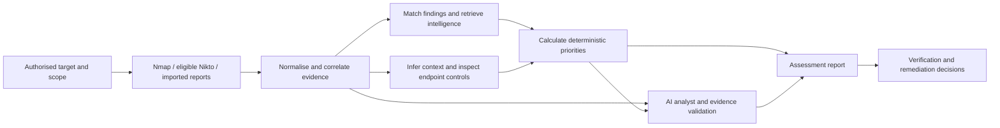

# VulnAssess
### AI-Based Network Vulnerability Assessment and Context-Aware Prioritisation

Turn authorised scan evidence into an understandable security assessment: what was observed, why it matters, what needs attention, and how to verify the next decision.

VulnAssess combines network and web scanner evidence, vulnerability intelligence, deployment context, deterministic risk scoring, and an AI analyst in a local web application. Its workflow canvas connects the assessment stages to their inputs, outputs, execution status and supporting evidence.

**Project status:** working research prototype. Live collection, intelligence retrieval and AI validation have separate outcomes; inspect the result for the assessment you actually ran. The project does not claim complete vulnerability detection or independently proven ranking accuracy.

[Quickstart](#quickstart) · [Capabilities](#capabilities) · [Workflow](#assessment-workflow) · [AI analyst](#how-ai-is-used) · [Reports](#understanding-the-report) · [Development](#development-and-verification)

## Why this project exists

A severity score describes a vulnerability in general. Deciding what to fix also requires deployment information: the service's purpose, exposure, relevant protections, evidence quality, and exploitation intelligence.

VulnAssess brings these inputs into one assessment. It preserves the scanner evidence, records the basis of context decisions, calculates reproducible priorities, and asks an AI model to explain the resulting case with citations.

The central research question is whether context and validated AI interpretation can make vulnerability assessment more useful and reliable than severity-only reporting.

## Capabilities

- **Authorised network discovery:** Nmap identifies reachable services and available fingerprints. The live discovery path uses the top 100 TCP ports with light service detection and can check an explicitly requested scoped endpoint.
- **Web and imported scanner evidence:** bounded Nikto checks for eligible web targets; import readers for Nmap, Nikto, completed Nessus reports and ZAP exports. Nessus and ZAP are import paths, not scanners launched by the application.
- **Finding normalisation and correlation:** common records preserve scanner identities and evidence; matching rules consolidate supported duplicates and retain provenance.
- **Vulnerability intelligence:** NVD product/CVE information and CVSS data, FIRST EPSS scores and percentiles, and CISA Known Exploited Vulnerabilities membership. Stored processing uses supplied snapshots; the live path supports targeted publisher requests and caching.
- **Context and priorities:** role, exposure and supported control signals inform configured scoring rules. Endpoint context shows service roles and protocol-relevant controls; missing controls remain unknown.
- **AI analysis:** selectable local or cloud providers generate structured interpretations, cited explanations, uncertainties and verification proposals. Validation checks the output before it is displayed.
- **Evidence-derived decisions:** reports connect observations to conclusions, practical consequences, actions, expected outcomes and evidence that would change the conclusion.
- **Self-defence:** a dedicated workspace reads supported Windows security posture and local service information, explains precautions, and supports saved comparisons.
- **Public Website Check:** a separate mode inspects one public HTTP/HTTPS root response, TLS trust/expiry and selected security metadata.
- **Saved assessments and reporting:** reopen retained captures, inspect raw proof where available, review source and configuration hashes, and download a self-contained HTML report.
- **Research tooling:** labelled synthetic demonstrations, role-model training/evaluation tools, frozen assessment snapshots, ranking comparisons, ablations and audit checks.

## Assessment workflow



Modules report whether they executed, failed, remain pending, or do not apply to the run. For example, a scan with no CVE-bearing findings cannot demonstrate CVE enrichment; a Redis assessment does not require HTTP-specific Nikto checks.

A URL identifies an entry point. It does not provide visibility into every host, internal network path or authenticated application function.

## Quickstart

### 1. Clone and install the Python package

Python **3.11 or newer** is required.

```bash
git clone https://github.com/codezxsWIN/de_Demo_recent.git
cd de_Demo_recent
python -m venv .venv
```

Activate the environment:

```powershell
# Windows PowerShell
.\.venv\Scripts\Activate.ps1
```

```bash
# macOS / Linux
source .venv/bin/activate
```

Install the declared Python dependencies and package:

```bash
python -m pip install -e .
```

### 2. Open the synthetic demonstration

```bash
python run_demo.py
python -m vulnassess --db data/vulnassess.db --config config ui --run demo --port 8765
```

Open [the local application](http://127.0.0.1:8765/) or [the workflow canvas](http://127.0.0.1:8765/workflow?run=demo).

The demo creates labelled synthetic data and a local database. It demonstrates processing and presentation; it is not a live vulnerability assessment. Captures from the maintainer's machine are not included in a fresh clone.

### 3. Prepare live assessment dependencies

- **Nmap:** install a complete distribution, including `nmap-protocols`, `nmap-services` and `nmap-service-probes`. Scanner preflight checks the required data files.
- **Nikto:** provide the Nikto script, Perl and its required modules for eligible web checks.
- **Scope:** review `config/scope.yaml` for your authorised environment before using live collection. Included lab addresses and historical target pins are configuration examples, not permission for a new operator.
- **Intelligence:** provide feed snapshots for stored processing, or use the configured live publisher lookup path.
- **AI:** configure a supported provider as described below.

For a Windows Nmap installation, an example process-level setting is:

```powershell
$env:VULNASSESS_NMAP_BIN = 'C:\Program Files (x86)\Nmap\nmap.exe'
```

If `NMAPDIR` is set, it must point to the complete Nmap data directory. Check readiness in the application before starting a run.

### 4. Run an assessment

Open the workflow, select **Run**, enter an authorised target, check scope and select the available assessment options. The workflow and module inspectors show progress, scanner coverage, provider attempts and validation results.

Use **Self-defence** for the computer running the application. Use [Public Website Check](http://127.0.0.1:8765/website-check) for the separate public metadata check.

## How AI is used

Supported analyst providers are **Ollama**, **Groq**, **Google Gemini**, and **OpenRouter**, including a separately configured secondary Groq option.

The analyst receives bounded assessment evidence: observed services, recorded findings, context, intelligence and calculated priorities. It can explain relationships, state uncertainty and suggest verification. Canonical priorities are calculated by the scoring engine.

Output validation checks structured fields, evidence references and quotations, finding/service identifiers, reported numbers, and supported classes of control and protocol claims. Rejected output is shown as needing review; provider failures are recorded independently from scan completion. These checks improve traceability but do not establish universal semantic correctness.

The optional decision-focus step selects existing supported verification actions and their premises. Reports label this selection separately from the underlying evidence-derived conclusions.

### Provider configuration

Keep real credentials in ignored local files or supported environment variables:

```dotenv
# .env
GROQ_API_KEY=your_own_key
OPENROUTER_API_KEY=your_own_key
```

```dotenv
# .env.google
GEMINI_API_KEY=your_own_key
```

```dotenv
# .env.groq2
GROQ_SECONDARY_API_KEY=your_own_key
```

For Ollama, install and run a suitable local model, then select it in the application. Model files are installed separately.

Cloud choices require evidence-sharing consent. Keys remain on the backend. Model names, quotas, latency and provider availability depend on the configured service.

See `.env.example` for configuration examples. Its PostgreSQL URL is a placeholder: remove or leave that variable unset to use local SQLite, or replace it with a valid backend database connection.

## How prioritisation works

The configured policy combines eligible CVSS v3.1 Environmental metrics with EPSS percentile and KEV membership. Supported context can affect the environmental calculation; unrelated or insufficiently supported control effects are withheld.

The current threat component starts with:

```text
threat = 0.5 + 0.5 × EPSS percentile
priority = environmental score × 10 × threat
```

KEV membership applies the configured multiplier and boost. The internet-facing KEV floor, score cap, risk bands, role requirements and test-environment overrides are defined in [config/weights.yaml](config/weights.yaml).

Reports retain the policy identity and, where the recorded inputs permit it, expose the calculation. Scanner-native fallback priorities are labelled separately. Missing required intelligence can leave a finding unscored.

These are project prioritisation rules and research hypotheses. Their practical benefit must be evaluated against independent reference rankings.

### Intelligence delivery and current limits

Already-recorded intelligence is reused rather than replaced by a second scoring
engine. The analyst receives at most two bounded HTTP(S) advisory references per
included CVE, with citable evidence and an explicit omitted-reference count. A
reference is not a verified fix, vendor identity or proof of local applicability.
Existing prompt and per-finding intelligence budgets still apply.

The findings view includes retained product/CPE-derived CVE associations as
candidates with their match method/confidence, without rewriting the scanner's
original CVE list. Reports show CWE identifiers as classifications. A finding with
no retained CVE association has no applicable per-CVE EPSS/KEV lookup; that is not
evidence that the system is safe. It does not imply a MITRE CWE definition or
mitigation was retrieved.

Comprehensive automatic CWE/CPE retrieval, expanded public-lookup coverage and
new cache/interface schemas remain proposed pending the required human-approved
ADR and source contracts. The existing targeted NVD/EPSS/KEV path is not a
six-source comprehensive integration. Publisher transports are **not run by the
agent**; no public API or feed retrieval was used to validate this delivery change.

## Understanding the report

A report should help the reader answer:

1. **What was checked?** Target, capture time, actual coverage, completed stages and failed checks.
2. **What was observed?** Services, findings, relevant endpoint context and available raw proof.
3. **What can we conclude?** Evidence-supported deductions, limits and competing explanations.
4. **What matters first?** Recorded priorities, intelligence inputs and applicable score explanations.
5. **What should happen next?** Specific verification actions, expected outcomes and decisions for each result.
6. **Can the explanation be traced?** Source references, hashes, AI status and cited evidence.

Saved reports are available at:

```text
/captures/<capture-id>/report
/captures/<capture-id>/report/download
```

The download is self-contained HTML suitable for sharing or browser print-to-PDF. Opening a saved report does not launch a scan or generate a new model response.

### Example: bounded Redis Lua assessment

The implemented Redis check inspects a fixed Lua expression and retains the request and response. A matching verified response can establish that the tested connection executed the expression and exposed the inspected loader function.

The report then derives decisions about approved-client access, Redis controls, package verification and a comparable retest.

**CVE-2022-0543 remains a package-dependent association until the distribution, installed package revision and vendor patch status are verified.** The bounded check does not establish successful native library loading or operating-system command execution.

## Assessment modes

**Authorised assessment:** scoped network discovery, eligible protocol/web checks, intelligence, priorities and optional AI interpretation.

**Self-defence:** supported checks on the machine running VulnAssess, including Windows firewall/Defender status, local listeners and available update information. Results include practical precautions and comparisons. Device checks depend on the operating system and available permissions.

**Public Website Check:** one public root response plus TLS and selected metadata. Redirect following, page-body retention, internal destinations and deep scanner execution are outside this mode.

**Imported assessment:** process supplied compatible scanner exports and available intelligence without launching those scanners.

## Data and reproducibility

- Local SQLite stores recorded assessment data; a PostgreSQL backend is also supported.
- The live intelligence cache is separate from the assessment database.
- Retained capture files, manifests and review checkpoints support reopening and provenance checks.
- Source snapshots and configuration identities support reproducible reporting.
- AI reanalysis of retained evidence has a new analysis time; it does not refresh the underlying scan or publisher data.

Git contains the application, configuration, tests, curated fixtures and UI assets. It excludes local databases, API keys, raw live captures, generated reports, installed scanners and downloaded model weights. Back up those local artifacts separately when needed.

## Useful commands

```bash
# Inspect the command surface
python -m vulnassess --help

# Import an existing authorised Nmap export
python -m vulnassess import --run-id lab1 --target-ip <authorised-ip> --nmap out.xml

# Load supplied intelligence snapshots
python -m vulnassess intel load --from-dir data/feeds

# Process and report a recorded assessment
python -m vulnassess enrich --run-id lab1
python -m vulnassess context --run-id lab1
python -m vulnassess rank --run-id lab1
python -m vulnassess report --run-id lab1 --out reports/lab1.html
```

Use `import --help` for Nikto, ZAP and Nessus inputs. Research, model, unification, snapshot, comparison and rescan commands are listed in the main help.

## Repository layout

```text
vulnassess/       scanning, readers, intelligence, context, scoring, AI and storage
vulnassess/ui/    local server, workflow, inspectors and report rendering
config/          scope, scoring policy, role and control configuration
scripts/         quality checks and saved-assessment utilities
tests/           regression, adversarial, integration and labelled synthetic cases
docs/            design records, technical reference and project guides
```

## Development and verification

The configured quality gate checks Ruff, formatting, Pyright and pytest coverage:

```bash
python scripts/check.py
```

Install the gate dependencies listed in [.github/workflows/ci.yml](.github/workflows/ci.yml) in your development environment.

At the latest save, **86 focused decision/report tests passed**. The broader quality-gate attempt reported formatting/type-check issues and test failures before it was stopped. A complete passing CI result for that save has not been established. Historical test counts and statement coverage do not establish vulnerability-detection accuracy or model reliability.

Independent labelled real-host cases, expert reference rankings, adversarial model evaluation and broader multi-vulnerability validation remain research work. The included role-model and fine-tuning tooling should not be presented as proof of a completed, independently evaluated training programme.

## Further reading

- [Project guide for everyone](docs/PROJECT_GUIDE_FOR_EVERYONE.md)
- [Technical project reference](docs/TECHNICAL_PROJECT_REFERENCE.md)
- [UI guide](docs/ui.md)
- [Security guide](docs/security.md)
- [Design and implementation decisions](docs/decisions.md)
- [Feed provenance](docs/FEED_PROVENANCE.md)

## License

[MIT](LICENSE). External scanners, models and intelligence sources retain their own terms.
