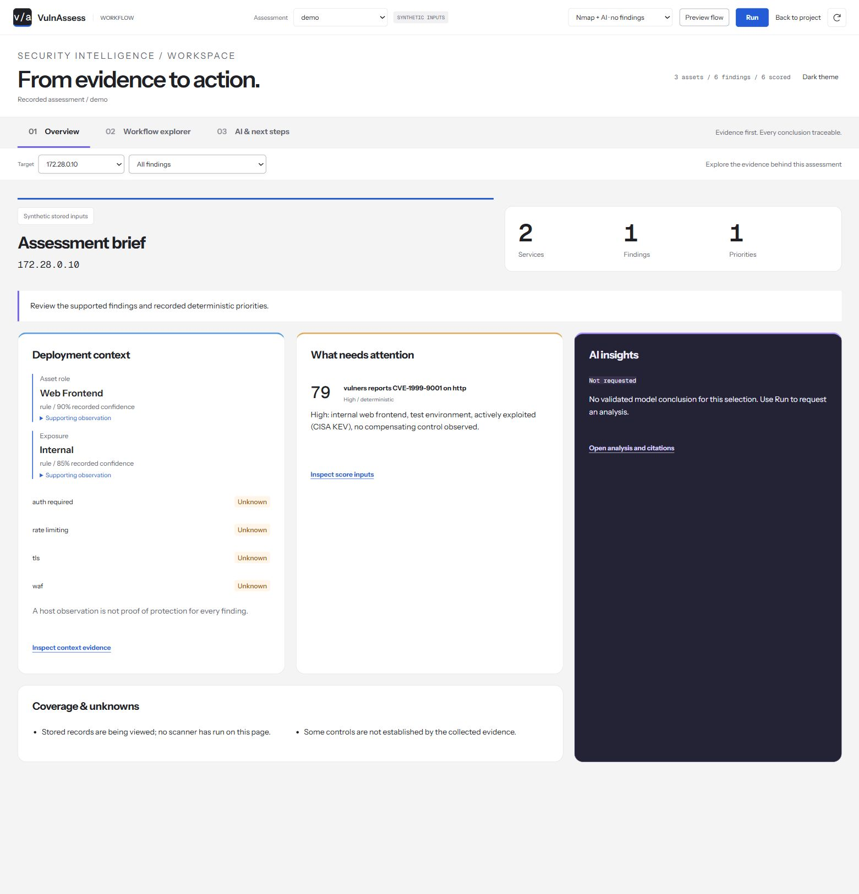
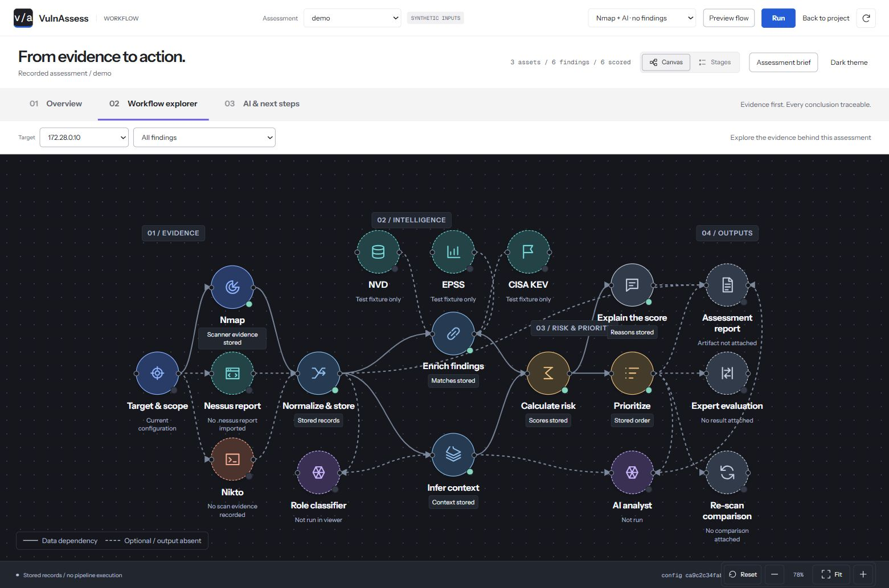
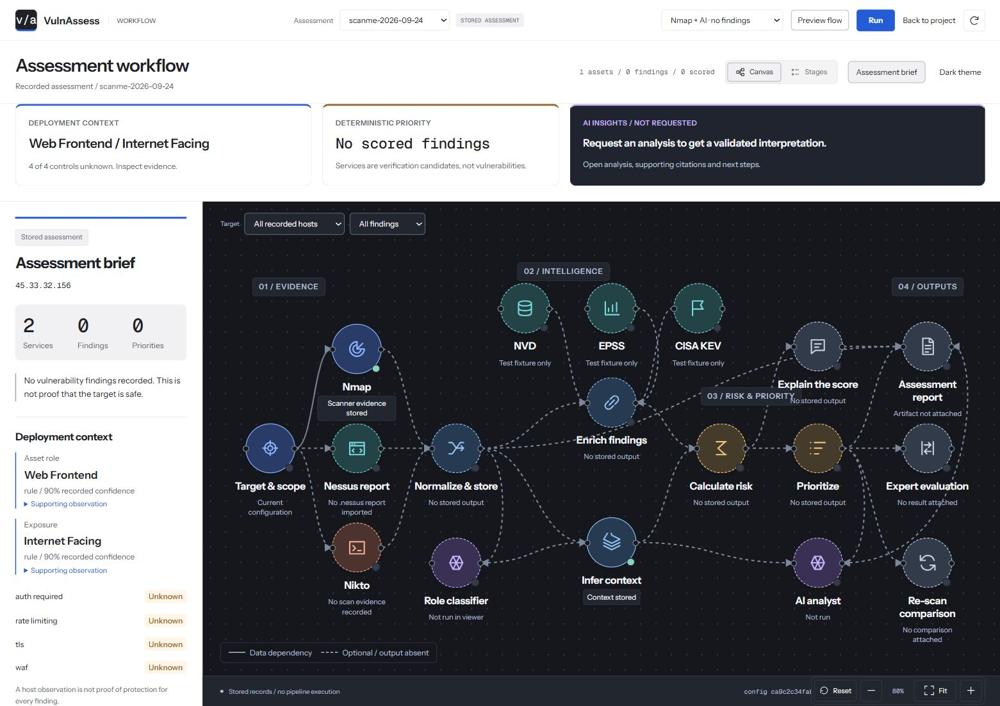

# Workflow UI refresh — 3 October 2026

## Goal

Make the assessment's context, deterministic priorities, validated AI interpretation,
next verification actions and coverage limits visible without hunting through node
inspectors. Give the workflow stronger visual hierarchy without changing what it runs.

## What changed

- A persistent three-part strip above the graph shows deployment context, the highest
  recorded deterministic priority and the validated AI interpretation or its honest
  unavailable/review state. Each part opens its existing inspector.
- A collapsible assessment brief sits beside the canvas. It presents service/finding
  counts, context provenance and supporting observations, control unknowns, priority
  rationale, AI context effects, citation IDs, next actions and coverage gaps.
- The default workspace pairs a light control shell with a charcoal dotted canvas.
  Circular modules have separate source, intelligence, transformation, risk, output
  and AI accents. Nikto also has a distinct web-scanner accent. An optional charcoal
  shell is available from the toolbar. There is no green page tint.
- Module color identifies a tool family, not execution. Dashed borders and explicit
  status text preserve unavailable, unexecuted and fixture-only states. Animation
  appears only through the existing selected/running/preview behavior, not as fake
  idle execution.
- Context and deterministic priority highlights have distinct accent rules; the AI
  interpretation occupies a larger, contrasting dark panel. The brief uses grouped
  counts, clear context provenance and visible unknown-control badges.
- Nodes, connectors and state labels have stronger contrast. Existing movable nodes,
  keyboard repositioning, zoom, fit, target/finding tracing and stage-list view remain.
- The live stage strip scrolls horizontally instead of consuming several rows above
  the graph. The run panel and inspector have more readable spacing and type sizes.
- On narrow screens, the brief becomes a normal stacked layout before the workflow.
  Touch controls are larger and reduced-motion preferences are respected.

## Data and trust constraints

`workflow-insights.js` is a presentation module, not a new assessment engine.

- It reads existing assessment records and validated live output. It never makes a
  scanner, intelligence-feed or provider request.
- It does not authorize targets, approve plans, alter scores or rewrite evidence.
- It filters stored priorities to the selected host/finding. Multi-host overviews do
  not borrow one host's context, and failed live runs do not borrow stored results.
- Historical `false / rule / none observed` controls display as **Unknown**, consistent
  with the existing inspector. The underlying record is not modified.
- Uncollected evidence is displayed as unavailable, not as zero observed findings.
- Synthetic stored inputs and animation previews stay explicitly labeled. Preview
  animations do not supply real context, scores or AI conclusions to the brief.
- Rejected AI prose is withheld. Multi-batch outputs keep citation namespaces and
  do not pretend to have a cross-batch synthesis.
- Target-controlled content is rendered with text nodes, never HTML interpolation.
- Theme switching is a page-local preference; it defaults to light after a reload.

## Implementation

- `vulnassess/ui/static/workflow-insights.js`: pure view model and safe text rendering.
- `vulnassess/ui/static/workflow-refresh.css`: additive workflow-only layout/styles.
- `vulnassess/ui/static/tokens.css`: light/dark semantic palette.
- `vulnassess/ui/static/workflow.html`: brief, highlights and theme/visibility controls.
- `vulnassess/ui/static/workflow.js`: view-model integration and presentation controls.
- `tests/synthetic/workflow_insights_check.mjs` and `tests/test_workflow_insights.py`:
  presentation regressions, no external targets or models.

The existing workflow stack was retained. No UI framework or runtime dependency was
added. The frontend and browser-testing skills guided accessible controls, explicit
empty/error states, responsive testing and runtime verification.

## Verification

The focused UI regression suite passes: **112 tests and 72 subtests**. It includes the
new brief contract and existing workflow, plan-review and evidence-request UI tests.

New assertions cover canonical-score preservation, host scoping, legacy unknown
controls, failed-run isolation, incomplete collection, retained capture dates,
synthetic labeling, preview isolation, rejected-output suppression, batch citation
namespaces and literal rendering of HTML-like scanner strings.
An additional regression ensures an empty global action summary cannot hide
batch-scoped next actions or remove their citation namespace.
The palette correction adds assertions for the light default, matching toggle label
and neutral background/paper/soft surfaces in both themes.
The expressive presentation adds assertions for a separate canvas palette, distinct
module-family accents, circular canvas nodes and the contrasting AI highlight.

Browser checks on the local server covered both themes, requested viewport widths
320/768/1024/1440, no horizontal overflow, target-specific briefs, the context
inspector, keyboard activation of the brief toggle, run-panel preservation and a
simulation-only full-web animation. Temporary viewport overrides were reset.
The main, muted, AI and risk text tokens all exceed 4.5:1 against the page's paper
background in both themes (minimum checked ratio: 5.89:1). This is a token-pair check,
not a claim that every rendered component has received a full accessibility audit.
Additional checks cover canvas text, AI highlight text, unknown-control badges and
module icons against their corresponding fills. Their minimum checked ratio is
4.91:1. Module icons are not the only means of identifying a tool: titles and status
text remain present. The latest browser pass verifies both shell themes, responsive
widths, context-inspector activation, keyboard brief toggling and run-panel opening.
The temporary viewport override is reset before handing the page back.

Ruff lint, Ruff format, JavaScript syntax checks and Pyright passed for the initial
refresh. Ruff lint/format and the JavaScript contract were rerun after the palette
correction and pass. Python production code is unchanged by this correction.

The full regression suite passed: **652 tests and 490 subtests**, with **86.07% Python
coverage**, exceeding the unchanged 85% gate. The new JavaScript assertions run
through the pytest wrapper; the Python coverage percentage is not a JavaScript
coverage measurement. After the palette correction, the full suite passed again:
**652 tests and 490 subtests in 98.07 seconds**, without coverage instrumentation.
The focused UI suite also passed again: **112 tests and 72 subtests**. The 86.07%
coverage result belongs to the initial refresh, not a new palette-only measurement.
After the expressive presentation update, the full suite passed again: **652 tests
and 490 subtests in 84.63 seconds**, without coverage instrumentation. The focused
suite passed **112 tests and 72 subtests**, and Ruff lint/format passed. No production
JavaScript or Python execution logic changed in this visual update.

Full-suite command:

```powershell
python -m pytest -q -p no:hypothesispytest --cov=vulnassess --cov-report=term --cov-fail-under=85
```

Palette-correction regression command:

```powershell
python -m pytest -q -p no:hypothesispytest
```

The optional Hypothesis pytest plugin was disabled for the existing Windows native
extension policy limitation; no project tests were deselected. Coverage emitted one
warning because Windows Application Control blocked its C tracer, and used its
Python tracer instead. No security protection was disabled.

These checks are not a claim of a full accessibility audit or production deployment.
No external scan or model call was made during this refresh.

## Remaining limitations

The brief exposes the context and AI conclusions already available to the app. It
does not make the context inference smarter or generate missing conclusions. A
stored assessment with no accepted AI analysis correctly shows **Not requested**.
The full evidence/score details remain in inspectors; the brief displays only the
first three priority rows and verification actions, with links to the complete view.

## Visual proof

### Focused overview (Hermes Agent reference)

The overview now uses a central reading area and a compact context rail, informed
by the navigation and expandable detail described in the official Hermes Agent
desktop documentation. A plain-language assessment verdict leads the page.
Counts are secondary. Up to five canonical priorities show their score, band,
asset (when recorded), and rationale together. The analyst section shows accepted
reasoning and verification actions. Context provenance is expandable, and
coverage limits remain visible beside the result.

The UI uses a dedicated presentation module, `workflow-overview.js`, which reads
the existing scoped brief without changing its evidence or scores. The contract
test checks literal rendering of untrusted finding titles, preservation of
canonical scores and reasons, rejection of withheld AI prose, and explicit
pending/preview/zero-findings states. The complete test suite passed with
652 tests and 490 subtests after this increment.

Reference: https://hermes-agent.nousresearch.com/docs/user-guide/desktop

### Assessment workspace upgrade (4 October 2026)

The workspace now opens on an outcomes overview. Three navigation destinations
separate Overview, Workflow explorer, and AI & next steps. Target and finding
filters are shared across all three. Context, recorded deterministic priorities,
AI status, and coverage are readable cards rather than a narrow default sidebar.
Evidence links open the existing node inspector; the optional canvas brief is
collapsed initially to give the draggable graph its full width. Preview and live
run entry points switch to the workflow. The project hero links directly to the
selected assessment workspace.

No scanner, model, scope, validation, or score semantics were changed. Synthetic
records remain labelled synthetic, unavailable AI remains unavailable, and the
overview reuses the existing scoped, fail-closed brief model. Loading failures
clear the overview instead of leaving stale conclusions on display.

Verification: focused UI/planner/evidence-request tests passed (112 tests plus
72 subtests); the final UI/brief rerun passed (91 tests plus 72 subtests). Browser
checks covered empty findings, populated synthetic records, target filtering,
overview/AI/canvas navigation, context drill-down, light/dark theme, and mobile
horizontal fit. No live scan or paid model call was made for these checks.

Current screenshots use explicitly labelled synthetic demo records:




### Earlier visual pass

The current screenshot shows the existing stored `scanme-2026-09-24` assessment in
the light shell with an expressive charcoal canvas. Its two services, zero findings
and missing accepted AI analysis are shown honestly. No new scan was launched for
this screenshot.



The earlier `workflow-insights-dark.jpg`, `workflow-insights-light.jpg` and
`workflow-neutral-light.jpg` files are retained as historical screenshots. They
show superseded designs, not the current presentation.
